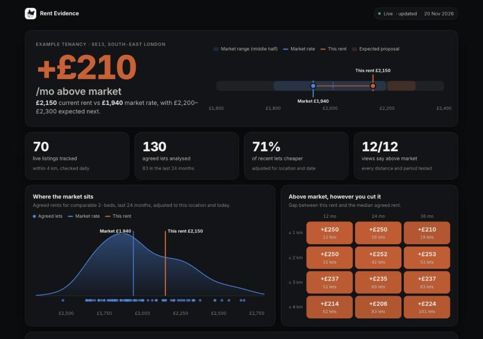
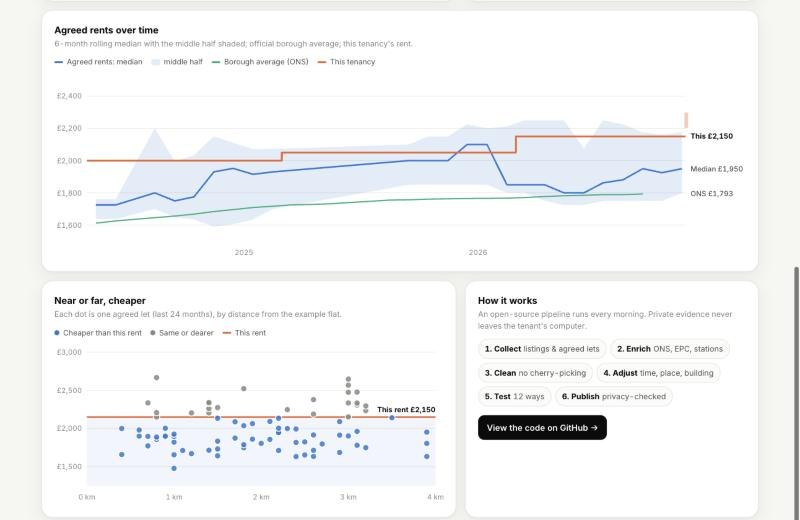
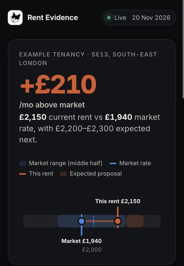
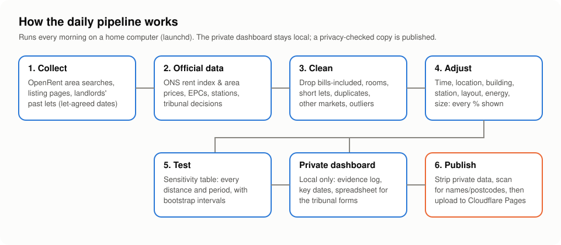

<p align="center">
  
</p>

<h1 align="center">Rent Evidence</h1>

<p align="center"><b>Gather your own evidence to challenge a rent increase at the First-tier Tribunal: automatically, every day.</b></p>

<p align="center"><a href="https://rent-evidence-demo.pages.dev"><b>Live demo →</b></a></p>

<p align="center">
  <a href="https://rent-evidence-demo.pages.dev"></a>
</p>

Since 1 May 2026 (the Renters' Rights Act 2025), a private landlord in England can only raise the rent with a
Section 13 notice (Form 4A), and the tenant can ask the First-tier Tribunal (Property Chamber) to decide the
open-market rent. The tribunal can't set more than the landlord proposed, and if it decides after the notice's
start date the new rent isn't backdated. What wins these cases is good evidence: comparable lets that really
are comparable, adjusted openly, and dated proof of the flat's condition.

This project builds that evidence for one flat, keeps it up to date every morning, and publishes an anonymised
copy so others can see how it works.

**Live demo:** [rent-evidence-demo.pages.dev](https://rent-evidence-demo.pages.dev) · a worked example for a two-bed flat in south-east London, rebuilt every morning.

## The public dashboard

One number up front (how far the rent sits above the market), four headline figures, and four charts:
where the market sits, a robustness grid (every distance and period), agreed rents over time against the
official ONS average, and every comparable let by distance. Hover anything for the figures behind it.
It follows the viewer's light or dark setting and works on a phone.

<p align="center">
  
  &nbsp;
  
</p>

The full working (evidence log, every adjustment line by line, tribunal decisions, a spreadsheet laid out for the
tribunal forms) stays in a private dashboard on the tenant's own computer.

## How it works



## What it does

| Step | Detail |
|---|---|
| **Collect** | OpenRent area searches embed every listing nearby, including recently let-agreed ones. Each listing page gives the let-agreed date; each landlord's page lists their past lets. Polite request rate, saved snapshots. |
| **Official data** | ONS Price Index of Private Rents (to bring older lets to today's money); ONS median flat prices by neighbourhood (MSOA) to adjust for location; EPC ratings and floor areas; railway stations from OpenStreetMap; published tribunal rent decisions nearby (via Rent Rise Check), each re-checked against the GOV.UK decision text. |
| **Clean** | Drops bills-included lets, rooms and HMOs, short lets, duplicate adverts, neighbourhoods that are a different price market, and statistical outliers. Comparables are chosen by similarity rules, **never by price**. |
| **Adjust** | An adjustment grid in the style a surveyor would use: time, location (how strongly rents follow area prices is *estimated from the data*), building type, station access, layout, energy rating, size, garden, parking, and the subject flat's open defects. Every percentage is shown line by line. |
| **Test** | A sensitivity table gives the median under every reasonable distance and period, with bootstrap intervals, so the conclusion doesn't depend on one filter. |
| **Evidence log** | Drop photos, saved emails and notes into `evidence/defects/<issue>/`; dates are read from the files themselves and a dated condition log is built. Optional AI review (Anthropic API) describes photos and pulls dated events out of correspondence. |
| **Outputs** | A private dashboard and a spreadsheet laid out for the tribunal forms (MR1/MR3), and a public, privacy-checked copy of the dashboard. |

## Privacy by design

- Everything about your own flat (address, rent, defects, correspondence, names) lives in `config_local.py`,
  `evidence/` and `notes/`. **None of it can be committed**: `.gitignore` is an allow-list of code files only.
- The public page (`public_site.py`) drops the evidence log, key dates, listing text, AI notes and full postcodes,
  then a privacy check scans the finished page for your blocklist words, email addresses and full UK postcodes.
  If anything is found, nothing is published and you get a notification.

## Run it for your own flat

```bash
python3 -m venv .venv && .venv/bin/pip install -r requirements.txt
cp config_example.py config_local.py      # then edit: your postcode, rent history, flat details
.venv/bin/python openrent_comps.py crawl  # first collection (takes a while; polite delays)
.venv/bin/python ons_index.py             # ONS rent index
.venv/bin/python area_prices.py           # neighbourhood prices + station distances
.venv/bin/python tribunal_decisions.py    # nearby tribunal decisions
.venv/bin/python openrent_comps.py export # spreadsheet + openrent_data/dashboard.html
```

Daily: `run_daily.sh` runs everything (crawl, checks, export, public copy). On a Mac, schedule it with a
LaunchAgent (`StartCalendarInterval`), or use cron elsewhere.

Optional keys (plain files next to the code, all git-ignored): `anthropic_key.txt` for AI review,
`epc_token.txt` for EPC floor areas, `cloudflare_token.txt` + `cloudflare_account.txt` (+ optional
`cloudflare_project.txt`) to publish the public page with `public_site.py --deploy` (uses Wrangler: `npm install`).

The ONS rent-index panels currently use the Lewisham series; change the area name in `ons_index.py` /
`dashboard.py` for another borough.

## Caveats

- Not legal advice. Check your notice and your options with Shelter or Citizens Advice.
- Adjustment percentages are judgement calls; they're visible so they can be challenged and changed.
- Use OpenRent data for your own research at a low request rate, and don't republish listing text or photos.
- ONS data: Open Government Licence v3.0. Stations: © OpenStreetMap contributors (ODbL).

MIT licence.
